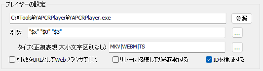

# 使い方概要

[`README.md`](./README.md)にも少し書いてありますがざっくりと使い方を説明します。

## おことわり:PCRPlayerとの比較

あらかじめ書いておきますが **FLVだけの再生ならPCRPlayerのほうが簡単かつ便利** です。
以下の比較はYAPCRPlayerからの視点です。

Pros:
- ほとんどのフォーマットの動画/配信を再生できる(MKVやFLVのAV1でも再生可能)
- コードが現代的かつQt依存なので比較的保守しやすい

Cons:
- 起動がやや重い
- (ライブラリ同梱なので)全体のサイズが大きい
- (チューニングを詰めていないので)メモリ使用量が多い
- UIが枯れていない、不親切

## PeCaRecorderからの起動方法

`C:\Tools\YAPCRPlayer\`内に`YAPCRPlayer.exe`が置いてあることを前提に説明します。

PeCaRecorderの歯車アイコンから"全般の設定"を開き、プレイヤータブで追加ボタンを押した後に以下のように設定してください。
この例ではPCRPlayerで再生できないMKV、WEBM、TSについてYAPCRPlayerを使うように指定しています。

一番上からそれぞれ:
- `C:\Tools\YAPCRPlayer\YAPCRPlayer.exe`は実行するファイルの場所(参照ボタンから選択できます)
- `"$x" "$0" "$3"`はPeerCastで再生する時のURL、チャンネル名、コンタクトURL(掲示板のURL)を引数に指定
- `MKV|WEBM|TS`は再生するストリームのタイプ(コンテナ)の正規表現

もしWMVやFLVもYAPCRPlayerで再生したいのなら最後の正規表現の部分を`WMV|FLV|MKV|WEBM|TS`のように追加すれば良いはずです。

## 操作方法

PCRPlayerと同様に **映像部分で右クリック** するとメニューが出ます。
そこからほとんどの操作が可能です。

チャンネル名部分にマウスカーソルを合わせるとレスの簡易表示が出ます。
PCRPlayerと異なりちゃんとした掲示板ブラウザは実装されていません。

下側の入力欄にレスを書いて右側の送信ボタンか`Ctrl`+`Enter`で掲示板に書きこみます。

メール欄をsageか空にするかはチャンネル名部分をマウスカーソルで右クリックすることで指定できますが、任意の文字列を指定することは現在できません。
この制限があるためbbs.jpnkn.comのbot書き込みブロック(Cloudflare Turnstile)が設定されている場合は書き込むことが出来ません。

## ショートカットキー

以下はデフォルトのキー設定のうちよく使うもの一覧です。

- ミュート: `m`
- 音量+: `↑`
- 音量-: `↓`
- 最上面表示切り替え: `t`
- フルスクリーン切り替え: `f`
- メニューバー表示切り替え: `x`
- ステータスバー表示切り替え: `b`
- 書き込み欄表示切り替え: `c`
- 表示倍率: `Ctrl`+`1`～`7`
- サイズプリセット: `Shift`+`1`～`9`
- アスペクト比: `Alt`+`1`～`7`
- 最小化ミュート: そんなものはない

## 設定

現在YAPCRPlayerには **設定UIを用意していません** 。
その代わりメニューバーの`表示`→`設定フォルダを開く`から見ることが出来る`config.toml`をテキストエディタで編集することで各種設定を変更することが可能です。
全ての設定をデフォルトに戻したい場合はいったんYAPCRPlayerを終了してから`config.toml`を削除してください。

なお`config.toml`はウィンドウ位置などの保存にも使われます(主に`[state]`セクション)。
この保存動作はYAPCRPlayerの終了時に行われます。

